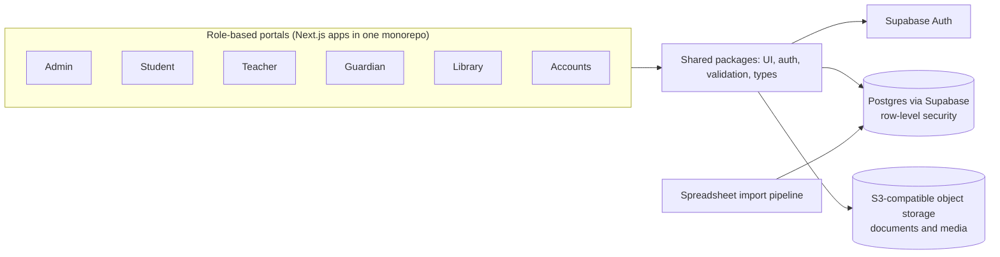

# Mediculum OS: Medical College Operating System (Discontinued)

> **Status: discontinued.** Mediculum OS is no longer an active product. This page is kept as a record of its architecture and design decisions.

> **Architecture case study.** Source code is private and owned by Start Daily xyz Limited. This repository contains original documentation only: no source code, data or credentials.

## Problem

Medical colleges share a common operating pattern (admissions, academic structure, attendance, assessments, library, fees) but are usually served by generic school software or one-off builds.

## Solution

Mediculum OS was Start Daily's own product. It generalised the architecture proven in client delivery into a reusable platform: role-based portals over one shared, policy-protected data model, configurable per institution. The product has since been discontinued.

## Architecture

## Modules

- **Admissions and records**: applicant to student lifecycle
- **Academics**: programmes, batches, courses, sessions
- **Attendance and assessment**: capture by faculty, visibility for students and guardians
- **Library**: catalogue and circulation
- **Finance**: fees, invoices, payments
- **Administration**: roles, users, institution configuration

## Tech stack

- TypeScript, Node.js 20
- Next.js apps in a pnpm + Turborepo monorepo
- Supabase (Postgres, Auth)
- S3-compatible object storage
- Zod, Vitest, Playwright

## Key design decisions

1. Productised from real delivery work, so the domain model reflects how medical colleges actually operate.
2. Institution-specific details live in configuration and data, not in forked code.
3. Database-level access policies keep each role's view correct regardless of which portal is used.
4. Shared packages for UI, auth and validation keep many portals consistent and cheap to maintain.

---

Designed and delivered by [Adil Ahmed](https://github.com/AdilAhmedAhir) at [Start Daily xyz Limited](https://startdaily.xyz), Dhaka.
